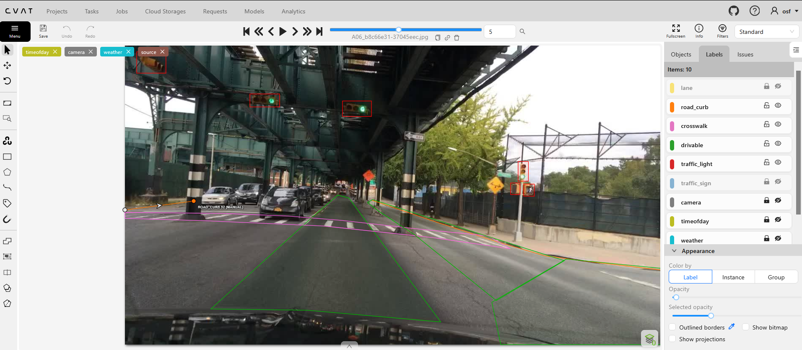
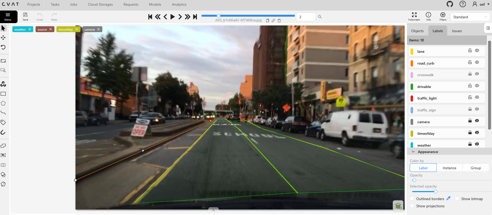
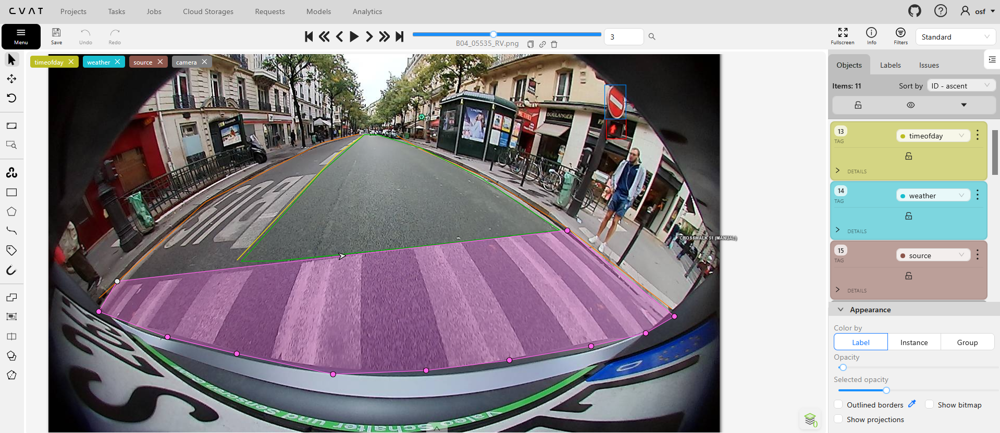

# Báo cáo cá nhân — Ngày 11
Họ tên: TRẦN TRỌNG HOÀNG VŨ               Mã học viên: 2A2026030261  
Phiên bản CVAT (Help → About): v2.74.1  
Guideline: Road v1.0    Lần nộp (`revision` trong manifest): 2  
Thời điểm export (ngày giờ trên CVAT): 2026-11-22 10:06:39 UTC    Số lần nộp lại sau Rework: 1  

## 1. Kiểm project
| Mục | Đúng như guideline Road v1.0? | Ghi chú |
| --- | --- | --- |
| 6 label, đúng kiểu | Đúng | Đủ 6 labels: `lane` (polyline), `road_curb` (polyline), `crosswalk` (polygon), `drivable` (polygon), `traffic_light` (rectangle), `traffic_sign` (rectangle). |
| Thuộc tính và giá trị | Đúng | Khớp hoàn toàn với file taxonomy `configs/road_v1_labels.json`. |
| 4 tag ảnh | Đúng | Đủ 4 tags: `camera`, `timeofday`, `weather`, `source`, mỗi tag có thuộc tính select `value`. |

Cách kết thúc polyline trên bản CVAT này: Nhấp chuột vẽ các điểm dọc tâm vệt sơn, sau đó nhấn phím **N** trên bàn phím để kết thúc đường.  
Cách đặt tag ảnh trên bản CVAT này: Chọn công cụ **Tag** ở thanh công cụ bên trái màn hình, chọn tên tag tương ứng, sau đó mở tab **Details** trong danh sách Objects bên phải để chọn đúng giá trị (`value`).

## 2. Số lượng đã gán
| Task | Ảnh | lane | road_curb | crosswalk | drivable | traffic_light | traffic_sign |
| --- | ---: | ---: | ---: | ---: | ---: | ---: | ---: |
| front | 12 | 27 | 19 | 4 | 25 | 24 | 30 |
| front-extra (đã làm 0 / 4) | 0 | 0 | 0 | 0 | 0 | 0 | 0 |
| fisheye | 8 | 6 | 17 | 9 | 8 | 4 | 2 |
| fisheye-extra (đã làm 0 / 4) | 0 | 0 | 0 | 0 | 0 | 0 | 0 |

## 3. Bảng ca khó
| Ảnh | Nhãn | Phân vân giữa | Đã chọn | Lý do |
| --- | --- | --- | --- | --- |
| A05_b2576c8c | lane | Có vẽ vạch mờ hay không | Không vẽ L1/R1, chỉ vẽ road_curb | Vạch sơn trên đường đã bị mòn hoàn toàn, không nhìn rõ tâm vệt sơn. Theo guideline và CHECKPOINTS, không vẽ bừa vạch không nhìn thấy để tránh sai số tâm > 5px. |
| A06_b8c66e31 | lane | Kéo dài vạch qua giao lộ hay ngắt | Dừng trước vạch ngựa vạn, không vẽ qua giao lộ | Trong khu vực nút giao không có vệt sơn dẫn hướng, vùng này là giao lộ có crosswalk. |
| A03_b1c66a42 | lane | Vạch vàng tim đường gán L1 hay R1 | L1 (solid, yellow) | Xe đang lưu thông ở làn bên phải, vạch tim đường màu vàng nằm sát mép trái làn xe chạy nên là L1. |
| B07_01216_MVR | lane | Gán position L1/R1 hay other | `other` | Guideline quy định đối với camera sườn (MVL, MVR), mọi vạch kẻ đường đều phải mang `position = other`. |

## 4. Phiếu QC 1 nhận được
Bạn kiểm lô của tôi: NguyenPhuongNga  
Quyết định nhận được: Rework (ở Revision 1)  

| Mã lỗi | Số lỗi | Đồng ý? | Đã sửa? |
| --- | ---: | --- | --- |
| QC1-01 (tag camera) | 3 | Đồng ý | Đã sửa: Sửa tag camera của `B01` thành `fisheye_front`; bổ sung đầy đủ 4 tag cho `A06` và `A07`. |
| QC1-02 (đủ L1, R1) | 2 | Đồng ý 1 phần | Đã sửa: Bổ sung vạch `R1` cho `A01`. Đối với `A05` và `A06`, mặt đường thực tế bị mòn/nút giao không có vạch sơn nên giữ nguyên không vẽ theo quy tắc Checkpoints. |
| QC1-03 (position) | 1 | Đồng ý | Đã sửa: Đổi toàn bộ thuộc tính position của các lane trên ảnh camera sườn `B07` và `B08` thành `other`. |
| QC1-05 (vạch đứt) | 1 | Đồng ý | Đã sửa: Gộp các đoạn vạch đứt bị tách rời trên `A01` thành một polyline duy nhất. |
| QC1-11 (fisheye theo cung) | 1 | Đồng ý | Đã sửa: Uốn cong thêm nhiều điểm neo dọc theo cung mép ảnh fisheye trên `B07`. |

## 5. Kiểm file export
| File | Mở lại được? | Số shape ảnh 1 (job / file) | Số shape ảnh 2 (job / file) | Tag camera có trong XML? |
| --- | --- | --- | --- | --- |
| TRANTRONGHOANGVU-front.zip | Có | 11 / 11 | 7 / 7 | Có (`<tag label="camera">...`) |
| TRANTRONGHOANGVU-fisheye.zip | Có | 5 / 5 | 8 / 8 | Có (`<tag label="camera">...`) |

## 6. Ảnh chụp màn hình
1. Tab Labels của project (đủ 6 nhãn hình và 4 nhãn tag với thuộc tính raw):
   
2. Ảnh camera trước A01/A03 đã gán đủ các lớp (lane, drivable, traffic_light, traffic_sign):
   
3. Ảnh fisheye B07 đã uốn polyline theo cung cong mép ảnh:
   
4. Đoạn XML trích xuất từ `annotations.xml` có `<polyline label="lane" source="manual">`:
```xml
<polyline label="lane" source="manual" occluded="0" points="115.07,715.84;362.50,504.99" z_order="0">
  <attribute name="position">L1</attribute>
  <attribute name="style">solid</attribute>
  <attribute name="color">white</attribute>
  <attribute name="kind">single</attribute>
</polyline>
```

## 7. Tự đánh giá
- **Lỗi mắc nhiều nhất hôm nay**: QC1-01 (quên gắn tag ảnh ở các bước đầu) và QC1-03 (quên đổi `position = other` ở camera sườn).  
  *Cách tránh ở Ngày 20*: Luôn tuân thủ quy trình 6 bước: gắn đủ 4 tag ngay khi mở ảnh trước khi vẽ hình; kiểm tra kỹ loại camera từ tên file (`_FV`, `_RV`, `_MVL`, `_MVR`) để chọn đúng thuộc tính position.
- **Nhãn của bạn đi vào model ở đâu? Chọn một lỗi đã sửa và nói nó làm model học sai thế nào**:  
  Nhãn đi vào mô hình đa nhiệm nhận diện làn đường (Lane Detection) và phân vùng lái được (Drivable Space Segmentation) phục vụ tính năng Hỗ trợ giữ làn (Lane Keeping Assist - LKA) và Lập kế hoạch quỹ đạo (Path Planning).  
  *Lỗi phân tích*: Nếu để vạch ở camera sườn mang nhãn `L1`/`R1` (thay vì `other`), mô hình sẽ học sai rằng có làn xe chạy hợp lệ song song ngay sát mạn sườn xe, dẫn đến hệ thống LKA ước tính sai hoàn toàn độ lệch tâm làn (lateral offset), có thể khiến xe tự động đánh lái chệch khỏi mặt đường hoặc cảnh báo rời làn sai lệch.

## 8. (Tùy chọn, buffer) Từ polyline đến đích row-anchor
| y | 720 | 680 | 640 | 600 | 560 |
| --- | ---: | ---: | ---: | ---: | ---: |
| x của chúng tôi (A01 - L1) | không có làn | 157.1 | 204.1 | 251.0 | 297.9 |
| x của bạn kia (A01 - L1) | 107.6 | 156.0 | 203.4 | 249.8 | 297.4 |

Trắc nghiệm & Trả lời 3 câu hỏi:
1. **Nếu dừng polyline sớm 40 px, hàng nào đổi thành "không có làn"?**  
   Hàng `y = 720` đổi thành "không có làn", vì điểm bắt đầu của vạch không kéo sát tới đáy ảnh (`y = 720`), chỉ bắt đầu từ `y ≈ 716`.
2. **So sánh độ lệch ở hàng 720 và hàng 560, hàng nào ảnh hưởng LKA nhiều hơn?**  
   Ở hàng 560 hai bên chỉ lệch nhau `0.5 px` (297.9 so với 297.4). Ở hàng 720 bài của bạn kia có tọa độ 107.6 px còn bài của chúng tôi bị mất điểm neo ("không có làn"). Sai lệch ở hàng 720 (sát đầu xe) ảnh hưởng đến LKA nhiều hơn rất nhiều, vì thuật toán điều khiển bám làn dựa trực tiếp vào điểm sát mũi xe để tính toán tức thời góc đánh lái và vị trí xe trong làn.
3. **Nếu polyline vẽ từ xa về gần (ngược quy tắc 2), cách tính trên có đổi không? Script nào sẽ gặp khó?**  
   Về mặt hình học thuần túy, đường cong nội suy qua các điểm vẫn xác định cùng tọa độ x. Tuy nhiên, các script tiền xử lý hoặc mô hình giả định thứ tự điểm từ đáy ảnh lên (gần ra xa) sẽ bị lỗi logic (ví dụ gán nhầm điểm bắt đầu là chân trời), dẫn đến việc phải duyệt ngược mảng hoặc thuật toán nội suy anchor bị đảo lộn chiều duyệt.
